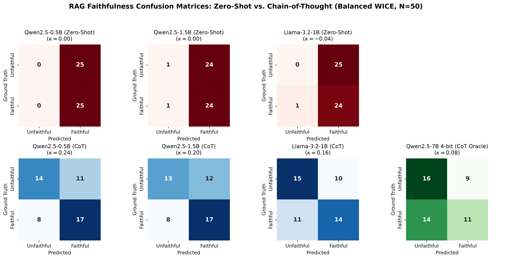

# Project Sentinel: Factuality & Citation Verification in RAG

**UT Austin CS388: Natural Language Processing – Final Project (Fall 2026)**  
**Track:** Factuality and Verification  
**Author:** Anirudh Paluri  

---

## Overview

**Project Sentinel** investigates whether lightweight, sub-2B instruction-tuned language models can serve as reliable, low-latency **LLM-as-a-Judge** verifiers for Retrieval-Augmented Generation (RAG) faithfulness.

Evaluating on a balanced 50/50 stratified subset of the WICE dataset ($N=50$ claims per model), we compare **Zero-Shot** vs. **Chain-of-Thought (CoT)** prompting across three sub-2B models (`Qwen2.5-0.5B-Instruct`, `Qwen2.5-1.5B-Instruct`, `Llama-3.2-1B-Instruct`) against a 4-bit quantized **7B Oracle baseline** (`Qwen2.5-7B-Instruct`).

### Key Findings

1. **Acquiescence Bias Is a Prompting Failure, Not a Hard Scale Wall:** Under Zero-Shot prompting, sub-2B models predicted `Faithful` **98.0%** of the time (147/150), yielding near-zero Hallucination Recall (`0.00–0.04`) and $\kappa \le 0.00$. Adding Chain-of-Thought prompting restored a balanced **54.0% Faithful / 46.0% Unfaithful** (81/69) distribution and increased Macro-F1 by **+0.231 to +0.286** at ~1.8x–2.2x latency.
2. **Sub-2B CoT Outperformed the 4-Bit 7B Oracle:** `Qwen2.5-0.5B-Instruct` with CoT achieved the highest overall agreement ($\kappa = 0.24$, Macro-F1 $= 0.619$) at **2.81x lower latency** than the 4-bit `Qwen2.5-7B-Instruct` Oracle (`3.58s` vs. `10.07s`).
3. **Skepticism Over-Correction at 7B:** While `Qwen2.5-7B-Instruct` achieved the highest Hallucination Recall (**0.64**), it over-corrected into skepticism—flagging **60.0%** of claims as `Unfaithful` (30/50)—which penalized precision and dropped Cohen's $\kappa$ to **0.08**.

---

## Experimental Results

*Evaluated on a stratified 50/50 split (`random_state=42`; 25 Faithful / 25 Unfaithful per model).*

| Model | Prompting | Precision | Cohen's $\kappa$ | Accuracy | Hallucination Recall | Macro-F1 | Avg Latency (s) |
| :--- | :--- | :---: | :---: | :---: | :---: | :---: | :---: |
| Qwen2.5-0.5B-Instruct | Zero-Shot | FP16 | 0.00 | 0.50 | 0.00 | 0.333 | 1.86 |
| Qwen2.5-1.5B-Instruct | Zero-Shot | FP16 | 0.00 | 0.50 | 0.04 | 0.366 | 2.22 |
| Llama-3.2-1B-Instruct | Zero-Shot | FP16 | -0.04 | 0.48 | 0.00 | 0.324 | 1.27 |
| **Qwen2.5-0.5B-Instruct** | **CoT** | **FP16** | **0.24** | **0.62** | 0.56 | **0.619** | 3.58 |
| Qwen2.5-1.5B-Instruct | CoT | FP16 | 0.20 | 0.60 | 0.52 | 0.597 | 4.84 |
| Llama-3.2-1B-Instruct | CoT | FP16 | 0.16 | 0.58 | 0.60 | 0.580 | 2.30 |
| Qwen2.5-7B-Instruct (Oracle) | CoT | 4-bit NF4 | 0.08 | 0.54 | **0.64** | 0.535 | 10.07 |

### Confusion Matrix Comparison



---

## Repository Structure

```text
NLPFinal/
├── data/
│   ├── raw/
│   │   └── enterprise_docs.csv              # Ground truth labels (WICE subset)
│   ├── processed/
│   │   └── corpus_chunks.csv                # Chunked evidence passages (E5 retrieval)
│   └── ground_truth/
│       ├── multi_model_evaluations.csv      # Sub-2B Zero-Shot judge outputs
│       ├── multi_model_evaluations_cot.csv  # Sub-2B Chain-of-Thought judge outputs
│       └── oracle_7b_cot.csv                # 7B 4-bit Oracle CoT judge outputs
├── src/
│   ├── compute_agreement.py                 # Computes Kappa, Accuracy, Recall, Macro-F1, Latency
│   └── plot_matrices.py                     # Generates 2x4 Zero-Shot vs. CoT confusion matrix plot
├── confusion_matrices_comparison.png        # Paper Figure 1
└── README.md
```

---

## Quickstart & Reproduction

### 1. Environment Setup

```bash
git clone https://github.com/apaluri18/NLPFinal.git
cd NLPFinal
pip install pandas scikit-learn matplotlib seaborn tabulate
```

### 2. Compute Evaluation Metrics

Run the agreement script against any of the three evaluation CSVs:

```bash
# Sub-2B Zero-Shot Baseline
python src/compute_agreement.py data/ground_truth/multi_model_evaluations.csv

# Sub-2B Chain-of-Thought (CoT)
python src/compute_agreement.py data/ground_truth/multi_model_evaluations_cot.csv

# 7B 4-bit Oracle Baseline
python src/compute_agreement.py data/ground_truth/oracle_7b_cot.csv
```

### 3. Regenerate Confusion Matrices

```bash
python src/plot_matrices.py
```

This outputs `confusion_matrices_comparison.png` in the repository root.

---

## Methodology Notes

* **Retriever:** `intfloat/e5-small-v2`
* **Binary Label Mapping:** WICE ground truth labels are mapped via exact string matching (`"supported"` $\rightarrow$ `1` Faithful; `"partially_supported"` / `"not_supported"` $\rightarrow$ `0` Unfaithful) to enforce strict citation verification and avoid substring-matching artifacts.
* **Verdict Extraction:** Judge outputs are parsed using regex over the post-prompt generated text, taking the final occurrence of `faithful`, `supported`, `unfaithful`, or `not supported`.
# Project Sentinel: Factuality & Citation Verification in RAG

Diagnostic evaluation of sub-2B open-weight language models as localized faithfulness judges on the **WiCE** benchmark (Kamoi et al., EMNLP 2023), benchmarked against an Unverified Accept-All baseline and a 4-bit NF4 `Qwen/Qwen2.5-7B-Instruct` Oracle under a paired retrieval ablation (**Random Single-Sentence** vs. **`intfloat/e5-small-v2` Top-3 Cosine Retrieval**).

## Key Findings (50-Claim Stratified Split: 25 Supported, 15 Not Supported, 10 Partially Supported)

- **Bipolar Zero-Shot Collapse:** Enforcing a one-word verdict schema in zero-shot prompting eliminated format fallback (`NoMatch` = 0.7%, 1/150), yet all three sub-2B models still collapsed ($\kappa \le 0.00$, Macro-F1 = 0.324–0.333) into opposite extremes: `Qwen2.5-0.5B-Instruct` predicted 100% `Faithful`, while `Qwen2.5-1.5B-Instruct` (98%) and `Llama-3.2-1B-Instruct` (100%) predicted `Unfaithful`.
- **CoT Recovery & Latency Trade-Off:** Chain-of-Thought (256-token budget) restored discrimination across every model family. Under the abstention-aware semantic parser, `Qwen2.5-0.5B-Instruct` (CoT) reached $\kappa = 0.24$ and Macro-F1 $= 0.619$ at **5.87s/claim** (2.53x faster than the 7B Oracle at **14.83s/claim**).
- **Retrieval-vs-Scale Crossover:** Upgrading from random single-sentence snippets (147.5 chars mean) to overlapping 80-word chunks with `e5-small-v2` Top-3 cosine retrieval (1,454.8 chars mean, 0.830 mean top-1 cosine similarity) recovered 6 previously missed `supported` claims and tripled the 4-bit `Qwen2.5-7B-Instruct` Oracle's agreement ($\kappa$: `0.08 -> 0.24`, Macro-F1: `0.535 -> 0.616`, Post-Verification Precision: **65.0%** vs. **50.0%** unverified baseline).

## Repository Layout

- `src/chunk_documents.py` — Sentence-level chunking utility for the initial single-sentence baseline.
- `src/evaluate_rag.py` — Baseline single-sentence multi-model evaluation script.
- `src/evaluate_rag_e5_top3.py` — Overlapping 80-word chunking + `intfloat/e5-small-v2` Top-3 cosine retrieval + rotational FP16 sub-2B & 4-bit NF4 7B evaluation on Colab T4 GPU.
- `src/compute_agreement.py` — Computes Cohen's $\kappa$, Accuracy, Hallucination Recall, Macro-F1, Post-Verification Precision, Retention, False-Negative Rate, parser ablations, and token/latency overhead.
- `neurips_report.tex` / `checklist.tex` — Final project report and ethics/reproducibility checklist.

## Reproducing Results

1. Authenticate with Hugging Face (`HF_TOKEN` in environment or Colab Secrets) so gated weights such as `meta-llama/Llama-3.2-1B-Instruct` can be loaded.
2. Run `src/evaluate_rag_e5_top3.py` on a CUDA GPU runtime to generate `e5_top3_evaluations.csv`.
3. Compute summary metrics and 3-way breakdowns:
   ```bash
   python src/compute_agreement.py --input_csv data/ground_truth/e5_top3_evaluations.csv
